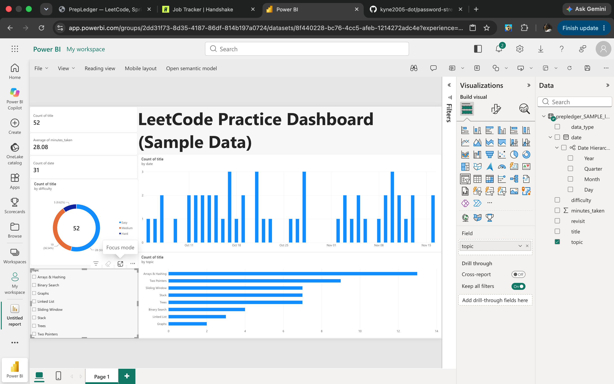

# LeetCode Practice Dashboard (Power BI)

A Power BI dashboard showing LeetCode practice trends: total problems
solved, active days, average solve time, daily activity, topic coverage,
and difficulty mix.

**Data:** This dashboard uses a SAMPLE dataset
(prepledger_SAMPLE_leetcode.csv) modeled on the export format of my
PrepLedger app. It is not my real practice history.

**Tools:** Power BI (cloud), CSV data

